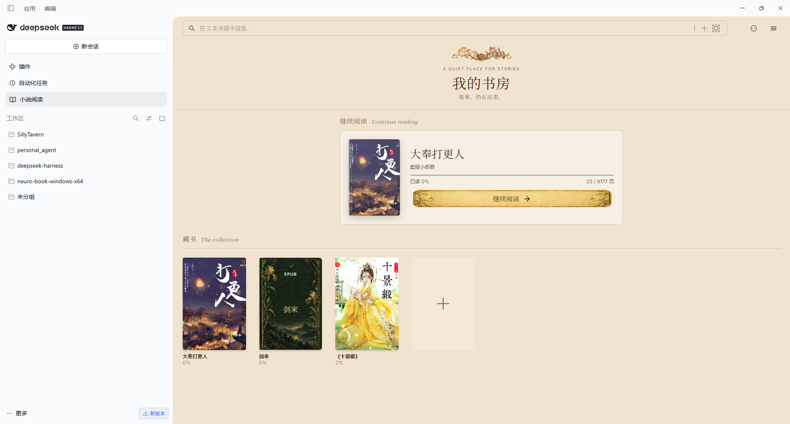
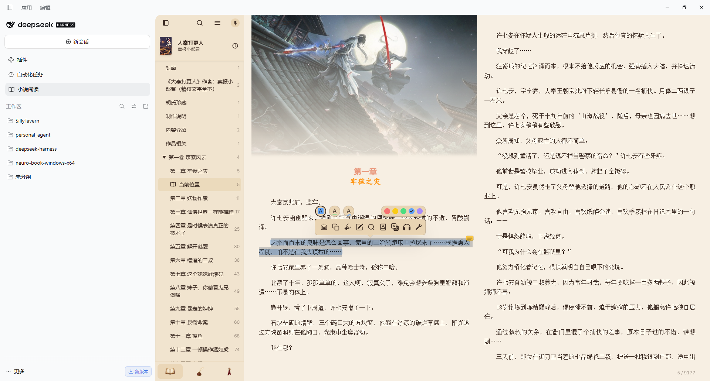
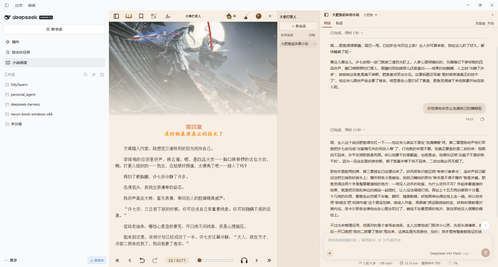
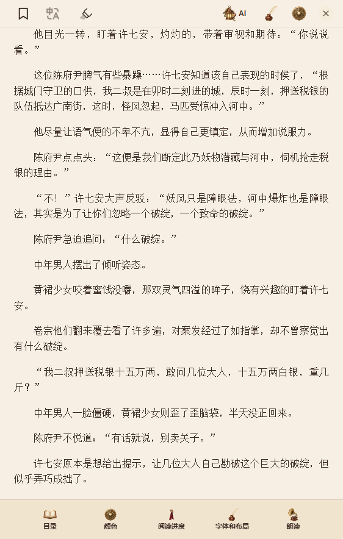

# DSH Novel ReadNest

基于 Readest 的 DSH 小说阅读插件，将本地书库、阅读器和书内 AI 会话放在一起。

[](https://github.com/yunasai0/dsh-novel-readnest/releases)
[](LICENSE)

## 功能

- 导入 TXT、EPUB，管理本地书架，记录阅读位置并继续阅读。
- 复用 Readest 的主题、字体、布局、目录、搜索、笔记和朗读界面。
- 每本书拥有独立的 Agent 会话列表，可新建、切换和管理会话。
- 复用 DSH 原生会话、输入栏和运行轨迹，支持引用选中文字与 AI 讨论。
- Agent 可通过 `read_novel` 查询当前页附近、当前章、指定章节和跨章范围。开启防剧透后，读取截止于发送消息时的当前页末尾。
- 内置默认人设和可编辑的「大肥鱼」人设，可在设置或会话顶部切换，从下一条消息生效。

## 功能截图

### 本地书库

在「我的书房」管理导入的小说，查看阅读进度，并从上次的位置继续阅读。



### 桌面阅读

桌面阅读页支持双栏排版，可在侧边目录切换章节，也可选中文字进行标注或向 AI 提问。



### 书内 AI 对话

阅读时可在正文旁打开本书的 AI 会话，选择「大肥鱼」等人设，并通过防剧透开关控制 Agent 可读取的正文范围。



### 窄屏阅读

窄屏下使用单栏正文，目录、配色、阅读进度、字体和朗读控件集中在底部。



## 安装

支持官方 DSH `0.2.1` 系列（从 `0.2.1-rc.2` 起）及 `0.2.2-rc.1`。插件包包含预构建模块与阅读页面，安装后由 DSH 直接加载。

### DSH Web

```sh
dsh plugin --profile web add "github:yunasai0/dsh-novel-readnest#v0.2.0-beta.7"
```

完成安装后，按 DSH 提示重启 Web 服务，刷新页面，从侧边栏「小说阅读」进入。

### DSH 桌面版

在桌面版的「插件 → 添加插件」中填写下列 GitHub 地址，安装并启用。

```text
https://github.com/yunasai0/dsh-novel-readnest
```

也可以在添加插件时填写 Release 附件的下载地址。Web 与桌面版使用同一份通用包。

```text
https://github.com/yunasai0/dsh-novel-readnest/releases/download/v0.2.0-beta.7/dsh-novel-readnest-0.2.0-beta.7.tgz
```

下载与校验文件见 [Releases](https://github.com/yunasai0/dsh-novel-readnest/releases)。

### 手机和平板

使用浏览器访问你部署的 DSH Web。阅读界面适配窄屏，AI 面板以可下拉收起的浮层展开。第三方 DSH 客户端需要支持官方版本的插件协议。

## 开始使用

1. 在「小说阅读」中导入 TXT 或 EPUB，打开书籍阅读。
2. 配置好 DSH 的模型后，点击阅读页顶部的「AI」，创建本书会话。
3. 选中文字后，可点击选区工具栏中的 AI 图标，将原文带入最近使用的本书会话。
4. 在「设置 → Agent 预设」中选择人设，或编辑「大肥鱼」的名称和提示词并保存。

防剧透开关位于 AI 会话顶部。关闭后，Agent 可以查询当前绑定书籍的全书正文。已有会话可能保留之前讨论过的内容。

## 数据与服务

书籍、阅读进度、笔记和人设设置保存在当前浏览器或桌面窗口的站点存储中。AI 会话保存在 DSH 数据目录。

朗读、外部词典和翻译依赖对应服务的可用性。AI 对话使用 DSH 中配置的模型与服务商。

## 兼容性与验证

| 环境 | 验证情况 |
| --- | --- |
| Windows DSH Web `0.2.1-rc.2` | 已验证 TXT、EPUB、续读、Agent 查章、防剧透、朗读及人设切换 |
| Windows DSH Web `0.2.2-rc.1` | 已验证安装、TXT 导入、打开正文和创建 AI 会话 |
| Windows 官方桌面版 | 通用包早期版本已验证导入、续读、Agent 与朗读，本版待复测 |
| 手机浏览器 | 已验证窄屏布局，移动真机待测试 |
| macOS、Linux 宿主 | 待实测 |

## 源码与构建

```text
src/               DSH Host、Client、Agent 与阅读协议
src/personas/      随插件提供的可编辑人设
vendor/readest/    适配后的 Readest 源码及其依赖锁文件
scripts/           构建和发布打包脚本
lib/               DSH 加载的预构建模块
reader/            预构建阅读页面与静态资源
cordis.patch.yml   DSH bundle 与 Agent 工具装配
```

维护者需要 Node.js 24 或更新版本，以及 pnpm 11。

```sh
pnpm install --frozen-lockfile
pnpm run build
npm run pack:release
```

发布脚本在 `dist/` 中生成带版本号的 `.tgz` 和 `.tgz.sha256`。GitHub 直装所需的 `lib/` 与 `reader/` 随源码提交。

构建、贡献与发布约定见 [CONTRIBUTING.md](CONTRIBUTING.md)，版本变更见 [CHANGELOG.md](CHANGELOG.md)。问题和建议请提交到 [Issues](https://github.com/yunasai0/dsh-novel-readnest/issues)。

## 许可证与致谢

本插件基于 [Readest](https://github.com/readest/readest) 适配，使用 AGPL-3.0-or-later。完整许可证见 [LICENSE](LICENSE)，来源与第三方说明见 [NOTICE.md](NOTICE.md)。
